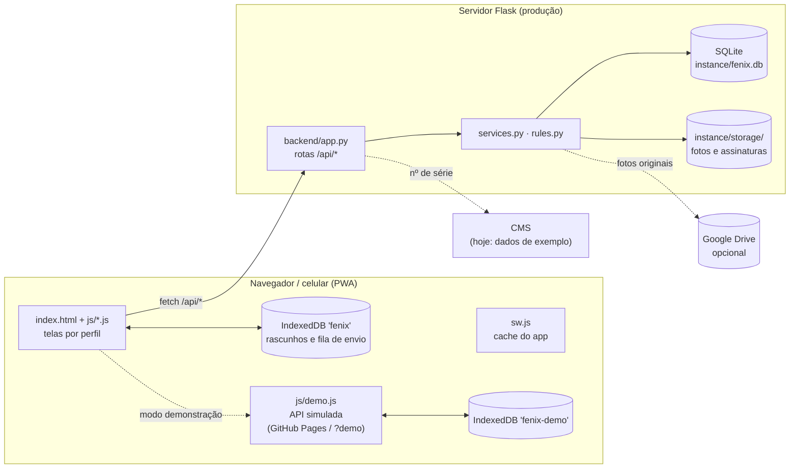
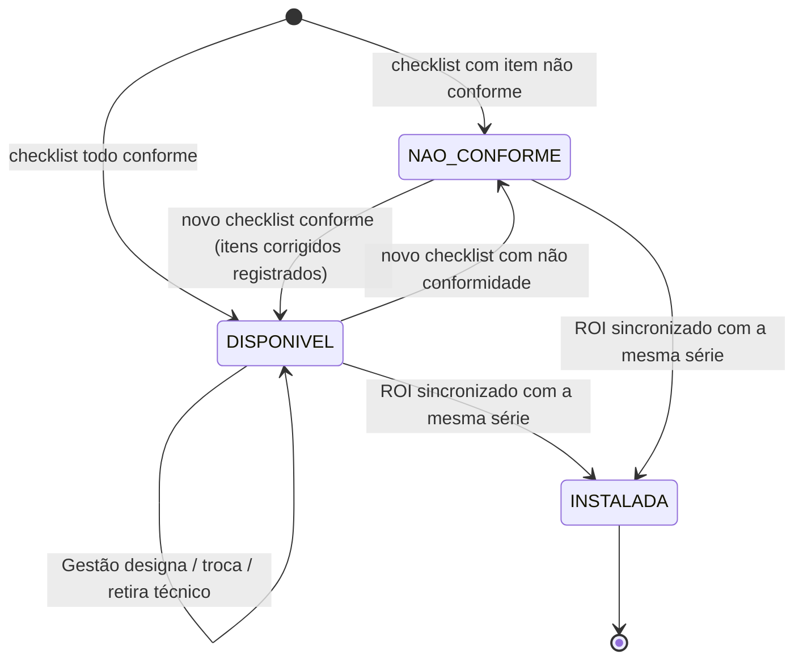
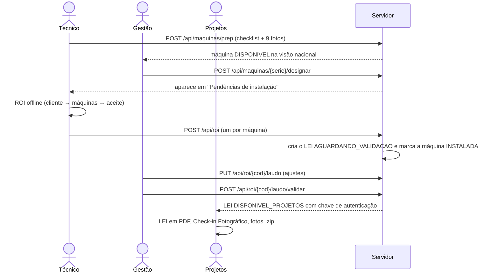
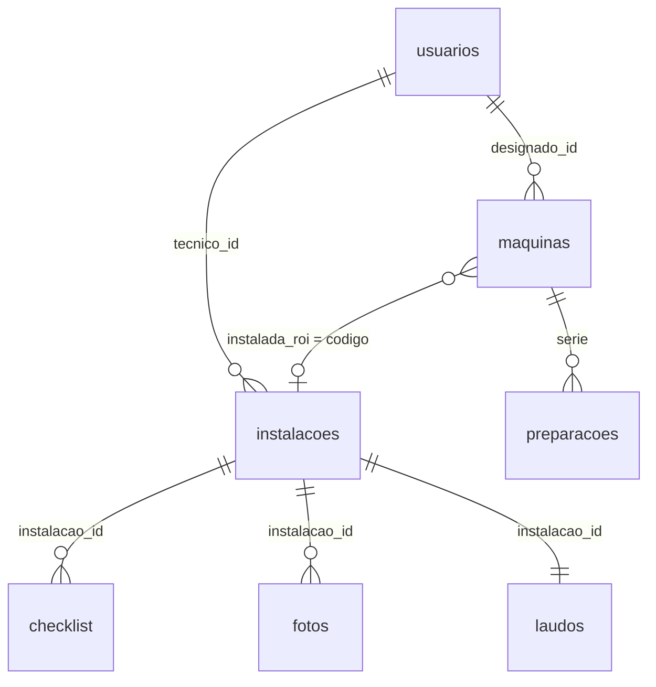

# Projeto Fênix — Documentação técnica

Sistema de registro da instalação da **Retorna Machine**: preparação da máquina na base, designação do técnico, instalação em campo (ROI), laudo validado pela Gestão (LEI) e relatórios ao cliente. O front é um PWA *mobile-first* e *offline-first* em JavaScript puro. O backend é Flask + SQLite. Uma réplica da API roda no próprio navegador para a demonstração no GitHub Pages.

> Versão documentada: `main` após o PR #5 (novembro de 2026). Para uso e roteiro de apresentação, veja o [README](../README.md).

## Sumário

1. [Arquitetura](#1-arquitetura)
2. [Tecnologias](#2-tecnologias)
3. [Estrutura do repositório](#3-estrutura-do-repositório)
4. [Como executar](#4-como-executar)
5. [Configuração](#5-configuração)
6. [Perfis e permissões](#6-perfis-e-permissões)
7. [Fluxo do processo](#7-fluxo-do-processo)
8. [Modelo de dados](#8-modelo-de-dados)
9. [API REST](#9-api-rest)
10. [Regras de negócio](#10-regras-de-negócio)
11. [Front-end](#11-front-end)
12. [Funcionamento offline](#12-funcionamento-offline)
13. [Fotos e evidências](#13-fotos-e-evidências)
14. [Relatórios e exportações](#14-relatórios-e-exportações)
15. [Modo demonstração](#15-modo-demonstração)
16. [Segurança](#16-segurança)
17. [Implantação em produção](#17-implantação-em-produção)
18. [Testes](#18-testes)
19. [Limitações e pendências](#19-limitações-e-pendências)
20. [Histórico de versões](#20-histórico-de-versões)

---

## 1. Arquitetura



- **Um só front para os dois modos.** `js/data.js` decide no carregamento: em `*.github.io` ou com `?demo` na URL, as chamadas `/api/*` vão para `js/demo.js`; caso contrário, vão por `fetch` ao Flask.
- **O servidor é a fonte da verdade.** O aparelho guarda só o que ainda não foi enviado (rascunhos e fila).
- **O Flask serve o front** por lista branca: `index.html`, `sw.js`, `manifest.webmanifest`, `icon.svg` e as pastas `css/`, `js/`, `vendor/`, `img/`. `backend/` e `instance/` nunca são expostos.

## 2. Tecnologias

| Camada | Tecnologia | Versão | Uso |
|---|---|---|---|
| Front | JavaScript (ES modules), HTML, CSS | — | Sem framework e sem etapa de build |
| Front | GSAP + ScrollTrigger | 3.12.5 | Animações de entrada e de rolagem |
| Front | Motion | 11.18.2 | Microinterações (toques, modais, toasts) |
| Front | anime.js | 4.0.2 | Contadores e desenho dos hexágonos |
| Front | Three.js | r160 | Cena 3D da tela de login (`js/scene.js`) |
| Front | ExcelJS | 4.4.0 | Relatórios em Excel (carregado só quando usado) |
| Front | JSZip | 3.10.1 | Download de fotos em .zip (carregado só quando usado) |
| Front | Service Worker, IndexedDB, Canvas, Geolocation | APIs do navegador | Offline, fila local, marca d'água, GPS |
| Backend | Python + Flask | Python 3.10+, Flask ≥ 3.0 | API REST e entrega do front |
| Backend | SQLite (`sqlite3` da biblioteca padrão) | — | Banco de dados |
| Backend | Werkzeug (vem com o Flask) | — | Hash de senha |
| Opcional | google-api-python-client, google-auth | ≥ 2.100 / ≥ 2.23 | Envio das fotos ao Google Drive |

Todas as bibliotecas do front ficam em `vendor/`, sem CDN. Assim o app funciona offline e respeita a política de segurança do servidor.

## 3. Estrutura do repositório

```
index.html               página única do app (carrega vendor/ e js/app.js)
manifest.webmanifest     manifesto do PWA
sw.js                    service worker: cache do app (rede primeiro, cache de reserva)
icon.svg                 ícone
iniciar_servidor.bat     atalho Windows: cria o .venv, instala o Flask e sobe a demo
.nojekyll                faz o GitHub Pages publicar os arquivos como estão
css/style.css            todo o estilo (tokens de cor, componentes, impressão)
js/
  app.js                 shell, login, roteador por hash, controle de acesso por rota
  data.js                constantes do domínio, cliente da API, IndexedDB, sincronização
  ui.js                  utilitários de DOM, ícones, toasts, modais, download
  scene.js               cena Three.js do login
  tecnico.js             app do técnico: visitas, wizard do ROI, fotos, assinatura, envio
  maquinas.js            checklist de preparação, máquinas disponíveis, designação, histórico
  painel.js              visão geral, laudos, editor do LEI, fotos, relatórios Excel, usuários
  docs.js                HTML do LEI, do ROI e do Check-in Fotográfico (impressão em PDF)
  demo.js                API simulada no navegador (modo demonstração)
img/demo/                fotos ilustrativas do seed (limpa e com marca); prep/ = checklist de preparação
vendor/                  bibliotecas de terceiros (seção 2)
backend/
  app.py                 rotas da API, autenticação, entrega do front, CLI
  services.py            casos de uso: gravar ROI e preparação, serializar, validar LEI, designar
  rules.py               regras: checklists, ROI → LEI, validação dos envios, preparação
  database.py            schema SQLite e migrações automáticas
  storage.py             armazenamento local e Google Drive
  cms.py                 consulta ao CMS (hoje com dados de exemplo)
  seed.py                usuários, laudos e máquinas de exemplo (só com FENIX_DEMO=1)
  requirements.txt       dependências (Flask)
  requirements-drive.txt dependências extras para o Google Drive
  instance/              gerado: fenix.db, storage/, secret.key (fora do Git)
docs/                    esta documentação
```

## 4. Como executar

### Demonstração no navegador (sem servidor)

- Publicada em https://tezzy05.github.io/Projeto_Fenix/.
- Localmente, sirva a raiz como arquivos estáticos e abra com `?demo`, por exemplo: `python -m http.server 8000` → `http://localhost:8000/?demo`.
- Abrir o `index.html` direto do disco (`file://`) não funciona, porque os navegadores bloqueiam ES modules nesse caso.

### Servidor Flask

Windows: dois cliques em `iniciar_servidor.bat` (opções `lan` e `reset`, ver README).

Linux/macOS:

```bash
python3 -m venv .venv
.venv/bin/pip install -r backend/requirements.txt
FENIX_DEMO=1 .venv/bin/python backend/app.py --host 127.0.0.1 --port 5000
```

Na primeira execução são criados `backend/instance/fenix.db`, `storage/` e `secret.key`. Com `FENIX_DEMO=1`, o seed é aplicado.

### Linha de comando

| Comando | Efeito |
|---|---|
| `python backend/app.py --host H --port P` | Sobe o servidor |
| `python backend/app.py --create-user ID "Nome" PERFIL [--ufs SP,RJ]` | Cria usuário e pede a senha (mín. 8 caracteres). `--ufs` define os estados do técnico |
| `python backend/app.py --passwd ID` | Redefine a senha |

## 5. Configuração

| Variável | Padrão | Efeito |
|---|---|---|
| `FENIX_DEMO` | `0` | `1` = cria usuários, laudos e máquinas de exemplo e mostra o "Acesso de demonstração" no login. Nunca use em produção |
| `FENIX_SECRET` | `instance/secret.key` (gerado) | Chave que assina o cookie de sessão. Em produção, defina um valor longo e aleatório |
| `FENIX_HTTPS` | — | `1` = cookie de sessão só por HTTPS |
| `FENIX_DATA` | `backend/instance` | Pasta do banco, dos arquivos e da chave |
| `FENIX_HOST` / `FENIX_PORT` | `127.0.0.1` / `5000` | Endereço e porta (também por `--host` e `--port`) |
| `FENIX_DRIVE_CREDENTIALS` | — | Caminho do JSON da Service Account do Google |
| `FENIX_DRIVE_FOLDER_ID` | — | Pasta de destino no Drive (precisa estar numa Unidade Compartilhada) |

Limite por envio: `MAX_CONTENT_LENGTH` = 150 MB, que comporta até 11 fotos originais mais a assinatura de um ROI.

## 6. Perfis e permissões

| Perfil (`perfil`) | Rotas do front | Escopo de dados |
|---|---|---|
| `tecnico` | `/tecnico`, `/maquinas` | ROIs que ele enviou; máquinas dos seus estados (`ufs`) ou designadas a ele, ainda não instaladas |
| `gestao` | `/painel`, `/laudos`, `/lei`, `/fotos`, `/maquinas` | Nacional; edita e valida o LEI; designa técnicos |
| `projetos` | `/painel`, `/laudos`, `/maquinas`, `/projetos`, `/fotos`, `/lei` | Nacional, somente leitura |
| `adm` | `/painel`, `/laudos`, `/lei`, `/maquinas`, `/projetos`, `/fotos`, `/usuarios` | Nacional, somente leitura e usuários |
| `consulta` | `/painel`, `/laudos`, `/fotos` | Só cliente, localidade, série, datas e fotos (a API remove o resto) |

- **No front**, `PERFIS` em `js/data.js` define o menu e as rotas permitidas; `route()` em `js/app.js` redireciona o que não estiver na lista.
- **No servidor**, que é quem garante a regra, o decorator `@auth(...perfis)` de cada rota devolve 401 sem sessão e 403 para perfil não autorizado. `get_roi_or_404` e `get_maquina_or_404` devolvem 404 ao que está fora do escopo do usuário, para não revelar que existe.
- **Relatórios em Excel** (`EXPORTA`): `gestao`, `adm` e `projetos`.

## 7. Fluxo do processo





## 8. Modelo de dados

O schema fica em `backend/database.py`. Datas são inteiros em milissegundos desde 1970 (UTC), no mesmo formato do JavaScript.



| Tabela | Colunas principais | Observações |
|---|---|---|
| `usuarios` | `id`, `nome`, `perfil`, `senha_hash`, `ativo`, `ufs` | `ufs` = estados do técnico separados por vírgula; vazio = qualquer estado |
| `instalacoes` | `codigo` (`ROI-AAAA-NNNN`), `client_uuid`, `tecnico_id/nome`, `cliente`, `ambiente`, `endereco`, `localizacao`, `uf`, `iniciado_em`, `encerrado_em`, `sincronizado_em`, `serie`, `pin`, `apk`, `modem_*`, `chip_*`, `avaria`, `obs`, `aceite_nome/doc/assinatura`, `drive_pasta`, `drive_status`, `grupo`, `maquina_i`, `maquina_n` | Um ROI por máquina. `client_uuid` (único) garante que o reenvio não duplica. `grupo` liga as máquinas da mesma visita |
| `checklist` | `instalacao_id`, `item`, `ok`, `obs` | 8 itens do ROI (seção 10) |
| `fotos` | `instalacao_id`, `slot`, `arquivo_orig`, `arquivo_marca`, `ts`, `lat`, `lng`, `drive_file_id`, `origem` | Slots `f1`–`f6` e `fx`, `fx2`–`fx5`; `origem` = `camera` ou `galeria` |
| `laudos` | `instalacao_id`, `status`, `tec`, `est` (JSON), `obs`, `termo`, `validado_por_id/por/em`, `chave` | `status` = `AGUARDANDO_VALIDACAO` ou `DISPONIVEL_PROJETOS` |
| `maquinas` | `serie` (PK), `pin`, `uf`, `status`, `designado_id/nome/por/em`, `ultima_prep`, `criado_em`, `atualizado_em`, `instalada_roi`, `instalada_em` | `status` = `DISPONIVEL`, `NAO_CONFORME` ou `INSTALADA` |
| `preparacoes` | `id`, `client_uuid`, `serie`, `tecnico_id/nome`, `uf`, `em`, `itens` (JSON), `conforme`, `corrigidos` (JSON), `fotos` (JSON) | Cada checklist de preparação; histórico completo por máquina |
| `eventos` | `instalacao_id`, `usuario_id`, `acao`, `detalhe`, `em` | Registro de ações: `ROI_SINCRONIZADO`, `LEI_EDITADO`, `LEI_VALIDADO`, `PREPARACAO`, `DESIGNACAO` |

**Migrações:** `init_db` roda `CREATE TABLE IF NOT EXISTS` e, para colunas acrescentadas depois da primeira versão (`MIGRATIONS`), faz `ALTER TABLE ... ADD COLUMN` quando a coluna falta. Bancos antigos são atualizados ao iniciar, sem perder dados.

**Arquivos** (`instance/storage/`): `roi/<codigo>/<slot>_marca.jpg`, `<slot>_orig.<ext>` e `assinatura.png`; `prep/<id>/<slot>_marca.jpg` e `<slot>_orig.<ext>`. `LocalStorage.path` bloqueia caminhos fora da pasta base.

## 9. API REST

Todas as rotas respondem JSON; erros vêm como `{"error": "mensagem"}` com o status HTTP. A sessão é um cookie assinado. O front chama tudo com `credentials: 'same-origin'`.

### Sessão

| Método e rota | Perfis | Entrada → saída |
|---|---|---|
| `GET /api/health` | público | `{ok, ts, demo, drive}` |
| `GET /api/login-options` | público | Com `FENIX_DEMO=1`: `{demo, senha, users[]}`; sem: `{demo:false, users:[]}` |
| `POST /api/login` | público | `{id, senha}` → `{id, nome, perfil, ufs[]}`; 401 inválido; 429 após 5 erros em 5 min |
| `POST /api/logout` | público | `{ok:true}` |
| `GET /api/me` | logado | `{id, nome, perfil, ufs[]}` |

### ROI e LEI

| Método e rota | Perfis | Descrição |
|---|---|---|
| `GET /api/roi` | todos | Lista (até 2.000, mais recentes primeiro), sem fotos. Técnico: só os seus. Consulta: versão reduzida |
| `GET /api/roi/<codigo>` | todos | ROI completo com LEI e URLs das fotos |
| `POST /api/roi` | tecnico | Multipart: `data` (JSON), `assinatura` (PNG), `mark_<slot>` e `orig_<slot>`. 201 criado, 200 se o `clientId` já existia |
| `PUT /api/roi/<codigo>/laudo` | gestao | `{tec[], est[], obs, termo}`. 409 se já validado |
| `POST /api/roi/<codigo>/laudo/validar` | gestao | Gera a chave e muda para `DISPONIVEL_PROJETOS`. 409 se já validado |
| `GET /api/roi/<codigo>/foto/<slot>?v=marca\|orig` | conforme escopo | Imagem; `orig` vem como download |
| `GET /api/roi/<codigo>/assinatura` | exceto consulta | PNG da assinatura |

Campo `data` do `POST /api/roi`:

```json
{
  "clientId": "roi-<uuid>",
  "iniciadoEm": 1794500000000,
  "closedAt": 1794502400000,
  "local": {"cliente": "...", "ambiente": "...", "endereco": "...", "localizacao": "...", "uf": "SP"},
  "equip": {"serie": "RM-2026-0147", "pin": "...", "apk": "...",
            "modem": {"op": "Vivo", "modelo": "...", "imei": "...", "ns": "..."},
            "chip": {"op": "Vivo", "linha": "...", "iccid": "..."}},
  "checklist": {"eletrica": {"ok": true, "obs": ""}, "...": "..."},
  "avaria": false,
  "obs": "",
  "aceite": {"nome": "...", "doc": "..."},
  "fotos": {"f1": {"ts": 1794500000000, "lat": -23.5, "lng": -46.6, "origem": "galeria"}},
  "grupo": "visita-<uuid> | null",
  "maquina": {"i": 1, "n": 2}
}
```

### Máquinas

| Método e rota | Perfis | Descrição |
|---|---|---|
| `GET /api/maquinas` | tecnico, gestao, adm, projetos | Lista com a última preparação, designação e instalação. Técnico: seus estados ou designadas a ele, sem as instaladas |
| `GET /api/maquinas/<serie>` | idem | Detalhe com `preps[]` (todas as tentativas, com fotos e `corrigidos`) |
| `POST /api/maquinas/prep` | tecnico | Multipart: `data` = `{clientId, serie, pin, uf, itens:{hw,sw,seg,modem,promo,adesiv:{ok,obs}}, fotos}` mais `mark_<slot>`/`orig_<slot>` para `i_<item>`, `mf`, `me`, `md`. 201 ou 200 (repetido). 409 se a máquina já foi instalada |
| `POST /api/maquinas/<serie>/designar` | gestao | `{tecnicoId}` designa; `null` retira. 409 se não estiver `DISPONIVEL`; 422 se o técnico não atua no estado |
| `GET /api/maquinas/<serie>/prep/<id>/foto/<slot>?v=marca\|orig` | idem | Foto do checklist |
| `GET /api/tecnicos` | gestao, adm, projetos | Técnicos ativos com `ufs` |

### Outras

| Método e rota | Perfis | Descrição |
|---|---|---|
| `GET /api/cms/<serie>` | tecnico, adm | `{pin, apk, modem, chip}`; 404 se a série não existe; 501 se o CMS não está configurado |
| `GET /api/usuarios` | adm | Usuários com `ufs` e `ativo` |
| `POST /api/admin/drive/retry` | adm | Reenvia ao Drive os ROIs com `drive_status = pendente`. 409 se o Drive não está configurado |

## 10. Regras de negócio

Ficam em `backend/rules.py` e `backend/services.py`. `js/demo.js` repete as mesmas regras.

### ROI

- **Campos obrigatórios:** cliente, ambiente, endereço, localização, estado (UF válida), série, PIN, APK, operadoras do modem e do chip, nome e documento do responsável.
- **Estado:** precisa estar entre os `ufs` do técnico quando ele tem estados cadastrados (422 caso contrário).
- **Checklist de 8 itens** (`CHECK`): `eletrica`, `acesso`, `conect`, `fixacao`, `espaco`, `limpeza`, `adesiv`, `estrut`. Todos respondidos; "não conforme" exige observação.
- **Fotos obrigatórias:** `f1`–`f6`; com avaria, também `fx` (canhoto do frete). `fx2`–`fx5` são opcionais. A assinatura precisa ser PNG.
- **Código:** `ROI-<ano>-<NNNN>`, sequencial por ano, gerado dentro de uma transação `BEGIN IMMEDIATE`.
- **Idempotência:** o mesmo `clientId` devolve o ROI já gravado, sem duplicar.
- **Máquina instalada:** ao gravar o ROI, a máquina com a mesma série (em maiúsculas) passa a `INSTALADA` com `instalada_roi` e `instalada_em`.

### Do ROI para o LEI (`build_lei`)

| Item do LEI | Fica conforme quando |
|---|---|
| Montagem física | `fixacao` |
| Espaço operacional | `espaco` |
| Componentes adicionais | `eletrica` |
| Conectividade | `conect` |
| Status de entrega | `eletrica`, `conect` e `acesso` |
| Adesivação (estética) | `adesiv` |
| Estrutura externa (estética) | `estrut` |

As observações do LEI juntam as observações dos itens não conformes, a nota de avaria e a observação do técnico. O termo de aceite padrão usa o marcador `[Nº Série]`.

### Validação do LEI

- Só a Gestão valida. A chave é `FNX-XXXX-XXXX-XXXX-XXXX`: os 16 primeiros caracteres do SHA-256 de `[tec, est, obs, termo, codigo, id do validador, data]`.
- Depois de validado, o laudo não pode ser editado (409).

### Preparação na base

- **Itens** (`PREP`): `hw`, `sw`, `seg`, `modem`, `promo`, `adesiv`. `promo` aceita `ok = null` (não se aplica).
- **Fotos:** uma por item respondido (`i_<item>`), mais `mf`, `me` e `md`.
- **Resultado:** conforme quando todos os itens são `true` (ou `promo` é `null`) → `DISPONIVEL`; senão → `NAO_CONFORME`.
- **Correções:** `corrigidos` = itens que eram `false` na preparação anterior e não são mais.
- Máquina `INSTALADA` não aceita novo checklist (409).

### Designação

- Só máquinas `DISPONIVEL`.
- O técnico precisa atuar no estado da base (ou não ter estados cadastrados).
- Registra quem designou e quando. `tecnicoId: null` retira a designação.

### Visita com várias máquinas

O app cria um ROI por máquina. Todos levam o mesmo `grupo` e `maquina = {i, n}`. `rules.visita` aceita `1 ≤ i ≤ n ≤ 50`.

## 11. Front-end

- **Roteador** (`js/app.js`): por hash (`#/rota/argumento`). `loadMe()` usa `/api/me` e, sem rede, a sessão em cache (`localStorage['fenix.me']`) para o técnico continuar offline.
- **Login:** usuário e senha. Com `demo` em `/api/login-options`, aparece o campo recolhido "Acesso de demonstração", com um botão por perfil (o primeiro usuário ativo de cada um). Para retirá-lo, apague o bloco `opts.demo` em `login()`.
- **Técnico** (`js/tecnico.js`): rascunho = visita `{local, maquinas[], stage, mi, ms}`. Etapas: `cliente` → por máquina (`Galpão e chegada`, `Local`, `Equipamento`, `Checklist`, `Fotos`, `Aceite`) → `resumo`. Rascunhos do formato antigo são convertidos por `upgrade()`.
- **Máquinas** (`js/maquinas.js`): para o técnico, a lista, o checklist de preparação (`#/maquinas/preparar[:serie|:rascunho]`) e "Iniciar instalação" (`draftFromMachine` + `sessionStorage['fenix.abrirRascunho']`). Para os demais, a visão nacional, a designação, o detalhe (`#/maquinas/<serie>`) e o Excel.
- **Painel** (`js/painel.js`): cards-filtro, fila de laudos, editor do LEI, visualizador em tela cheia, seletor de fotos, Projetos e usuários. `writeXlsx()` é a função comum dos relatórios.
- **Documentos** (`js/docs.js`): LEI, ROI e Check-in Fotográfico em HTML, impressos em PDF via `iframe` com o mesmo CSS.
- **Visual:** paleta Ambipar (lima `#CCFF03`), fonte Exo 2 (provisória; o alvo é a Neo Sans), animações que respeitam `prefers-reduced-motion`.

## 12. Funcionamento offline

| Peça | Detalhe |
|---|---|
| Service worker (`sw.js`) | Cache `fenix-vN` com o app; estratégia "rede primeiro, cache de reserva"; `/api/*` nunca vem do cache. Suba `V` a cada versão |
| IndexedDB `fenix` (store `roi`) | Rascunhos (`draft: true`), ROIs na fila (`sync: 'pendente'`) e checklists de preparação (`kind: 'prep'`) |
| Sincronização (`syncAll`) | Envia cada pendente em `FormData`. Erro de rede, 401 ou 5xx → tenta depois. 4xx → marca `syncError` (recusado). Depois do envio, apaga o original do aparelho |
| Estado de rede (`net`) | `navigator.onLine`, ping a `/api/health` a cada 8 s e o botão "Simular offline" |
| Lista de máquinas | Última consulta em `localStorage['fenix.maquinas.<usuário>']` |

## 13. Fotos e evidências

- **Marca d'água** (`watermark` em `js/tecnico.js`): canvas de até 1.600 px com faixa de data/hora, GPS (± precisão) e legenda (cliente · ambiente · foto), em JPEG 82%. A original vai junto (`orig_<slot>`).
- **Galeria** (fotos 1 e 2): `exif()` lê do JPEG a data de captura (`DateTimeOriginal`) e o GPS. Sem EXIF, usa a data do arquivo e "GPS indisponível". A marca indica "foto da galeria" e `origem = 'galeria'` fica gravado.
- **Download limpo** (Projetos, ADM, Consulta): o `.zip` usa as originais, organizadas em `Cliente/ROI_Ambiente/ROI_slot_Nome.jpg`.
- **Google Drive** (opcional): depois de gravar o ROI, `push_to_drive` envia as originais para uma subpasta por código. Se falhar, a sincronização não para: `drive_status = 'pendente'` e o ADM pode reenviar.

## 14. Relatórios e exportações

| Relatório | Onde | Conteúdo |
|---|---|---|
| ROI (Excel) | Laudos → Exportar relatório | 43 colunas: local, técnico, datas, equipamento, 8 itens com observação, avaria, observações, responsável, máquina da visita |
| LEI (Excel) | idem | Status, itens técnicos e estéticos, observações, termo, validador, data e chave |
| Máquinas (Excel) | Máquinas → Exportar relatório | 27 colunas: situação, designação, última preparação (6 itens com observação), itens corrigidos, instalação |
| LEI (PDF) | LEI / Laudos disponíveis | Documento do cliente com assinaturas |
| ROI (PDF) | App do técnico / LEI | Documento interno com fotos e assinatura |
| Check-in Fotográfico (PDF) | Projetos → Fotos | Capa, dados do local, fotos 3–5, encerramento |
| Fotos (.zip) | Fotos | Originais limpas, por instalação ou em lote |

Os filtros de data, cliente, estado e técnico vão para a aba "Filtros" de cada planilha. As datas são gravadas no fuso local.

## 15. Modo demonstração

- **Ativação:** host `*.github.io` ou `?demo` na URL (`LOCAL` em `js/data.js`).
- **`js/demo.js`** atende as mesmas rotas com as mesmas regras do Flask e responde objetos `Response`. Estado e arquivos ficam no IndexedDB `fenix-demo`; a sessão, em `localStorage['fenix.demo.uid']`.
- **Seed:** usuários, 9 laudos (SP, RJ, MG, PE, BA, MA, incluindo uma visita com 2 máquinas) e 8 máquinas, com as fotos de `img/demo/`. `SEED_VERSION` força o recomeço quando o formato muda.
- **"Restaurar dados de exemplo"** (`POST /api/demo/reset`): apaga o que foi testado naquele navegador.
- **Usuários:** senha `fenix123` para todos. Técnicos: `tec1` André (SP, RJ), `car` Carlos (SP, MG), `mar` Marcos (MG), `joa` Joana (PE, BA), `raf` Rafael (BA, MA). Gestão: `pat`, `her`, `rod`. Projetos: `tha`, `ana`. ADM: `and`, `cur`, `duf`. Consulta: `bia`.
- **CMS de exemplo:** `RM-2026-0147`, `0152`, `0160` e `0163`.

## 16. Segurança

- **Senhas** com hash do Werkzeug; sessão em cookie assinado, `HttpOnly`, `SameSite=Lax`, `Secure` com `FENIX_HTTPS=1`, validade de 30 dias.
- **Tentativas de login:** 5 erros em 5 minutos por IP e usuário → 429.
- **Cabeçalhos:** `Content-Security-Policy` restritiva (scripts só da própria origem), `X-Content-Type-Options: nosniff`, `Referrer-Policy: same-origin`; respostas JSON com `Cache-Control: no-store`.
- **Arquivos:** o tipo é conferido pelo conteúdo (`sniff_ext`: JPEG, PNG, WebP, HEIC), não pelo nome. Caminhos são confinados à pasta de armazenamento. O front estático é servido por lista branca.
- **Escopo dos dados:** reforçado no servidor (seção 6). A Consulta recebe uma versão reduzida (`consulta_json`), sem checklist, LEI, equipamento técnico nem assinatura.
- **Fora do Git** (`.gitignore`): `backend/instance/` (banco, fotos, `secret.key`), `__pycache__/` e `.venv/`.
- **Demonstração:** o login é simulado (senha conhecida) e os dados ficam no navegador. Não use com dados reais.

## 17. Implantação em produção

Alvo previsto: PythonAnywhere (ou qualquer servidor WSGI com HTTPS).

1. Suba o repositório, crie o virtualenv e rode `pip install -r backend/requirements.txt` (mais `requirements-drive.txt` para o Drive).
2. WSGI: `sys.path.insert(0, '/home/USUARIO/fenix/backend'); from app import app as application`.
3. Variáveis: **sem** `FENIX_DEMO`; `FENIX_SECRET` longo e aleatório; `FENIX_HTTPS=1`; `FENIX_DATA` fora da pasta do código.
4. Crie os usuários pelo comando `--create-user` (técnicos com `--ufs`).
5. HTTPS é obrigatório: câmera, GPS e instalação como app só funcionam em contexto seguro.
6. Para o Drive: Service Account com acesso a uma pasta de Unidade Compartilhada.
7. Backup: copie `FENIX_DATA` (banco e `storage/`) regularmente.

## 18. Testes

O repositório ainda não tem testes automatizados. Em cada PR, as validações foram feitas de ponta a ponta no Chromium (Playwright), no modo demonstração e no Flask, com o test client do Flask e conferência dos arquivos gerados (Excel com openpyxl, .zip). Os roteiros cobriram:

- login por formulário e pelo acesso de demonstração;
- permissões de cada perfil, inclusive bloqueios na API;
- ROI completo com fotos, assinatura, avaria e várias máquinas;
- reenvio sem duplicar;
- estado fora da área (422);
- validação do LEI;
- checklist de preparação conforme e não conforme;
- correção registrada;
- designação restrita ao estado;
- máquina instalada após o ROI;
- relatórios Excel e downloads .zip;
- leitura de EXIF da galeria;
- migração de bancos de versões anteriores.

**Sugestão:** transformar esses roteiros em testes automatizados (pytest para a API, Playwright para o front) num próximo ciclo.

## 19. Limitações e pendências

- PDF gerado pelo navegador ("Salvar como PDF"); falta gerar no servidor.
- CMS real não integrado (`backend/cms.py` devolve dados de exemplo).
- Usuários são criados por comando; não há tela de cadastro.
- Google Drive implementado, mas não testado com o Drive da Ambipar.
- Falta definir retenção (≥ 30 dias) e rotina de backup das fotos.
- Logo oficial e fonte Neo Sans ainda provisórios.
- Ligação do relatório fotográfico com a apresentação padrão do Drive (próximo momento).
- SQLite atende o volume previsto. Para muitos acessos simultâneos, a camada `database.py` pode trocar para MySQL/PostgreSQL sem mudar as rotas.

## 20. Histórico de versões

| PR | Conteúdo |
|---|---|
| [#1](https://github.com/Tezzy05/Projeto_Fenix/pull/1) | Login no modelo da Jornada TECSO e demonstração no GitHub Pages (`js/demo.js`) |
| [#2](https://github.com/Tezzy05/Projeto_Fenix/pull/2) | Acesso de demonstração com um botão por perfil |
| [#3](https://github.com/Tezzy05/Projeto_Fenix/pull/3) | Cards-filtro, busca e filtros, Excel de ROI/LEI, fotos em tela cheia, .zip de fotos, perfis Projetos e Consulta, estados dos técnicos, vários rascunhos, até 5 fotos de avaria |
| [#4](https://github.com/Tezzy05/Projeto_Fenix/pull/4) | Fotos 1 e 2 antes do checklist (câmera ou galeria) e várias máquinas por cliente |
| [#5](https://github.com/Tezzy05/Projeto_Fenix/pull/5) | Checklist de preparação na base, máquinas disponíveis, designação pela Gestão e visão nacional |
